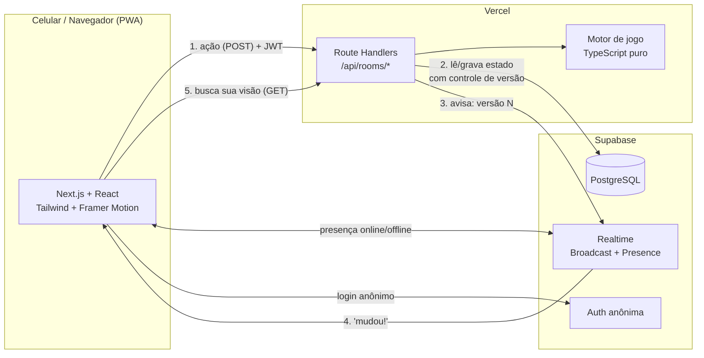
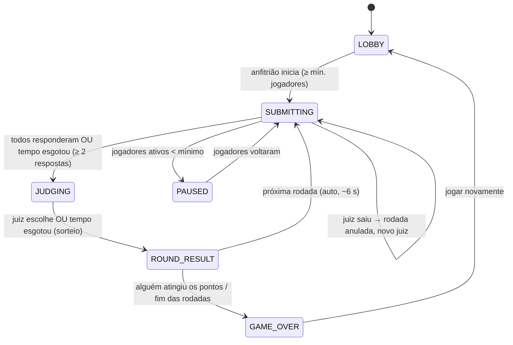
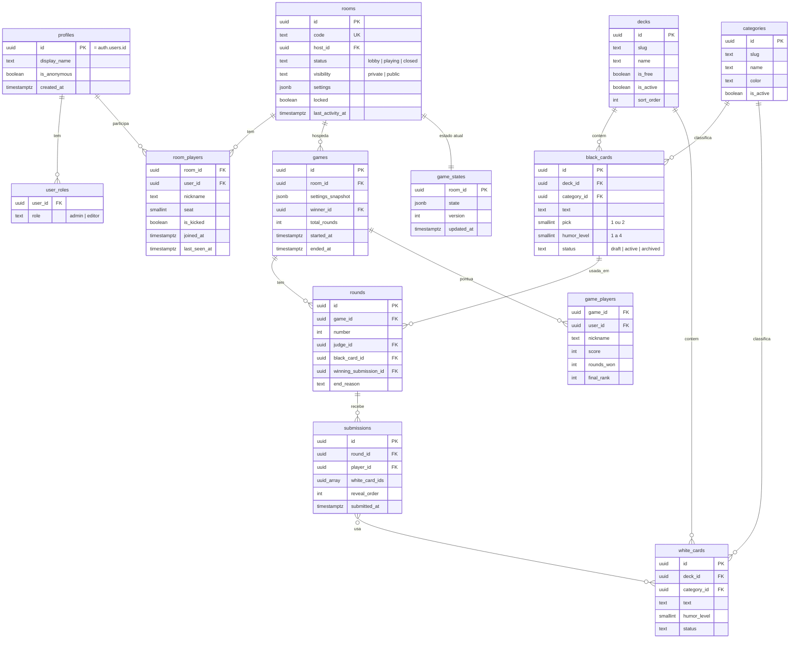
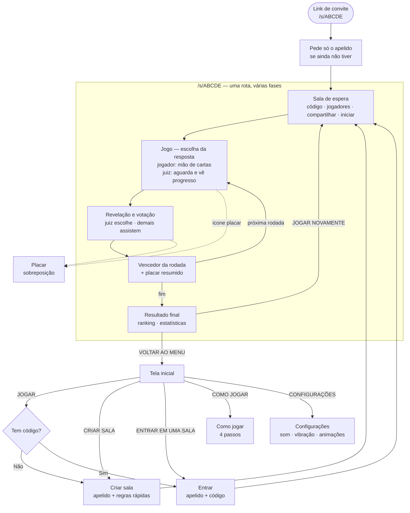

# PLANO DE DESENVOLVIMENTO — PATUSCADA

> Versão 1.1 · 23/11/2026 · Status: **aprovado com decisões D1, D2 e D10 registradas** · Etapa atual: 2 (identidade visual)
> Papéis nesta etapa: Product Manager + Arquiteto de Software
> Nenhuma linha de código de produto foi escrita. A implementação começa depois da sua aprovação.

---

## Sumário

1. [Diagnóstico do ambiente](#1-diagnóstico-do-ambiente)
2. [Entendimento do produto](#2-entendimento-do-produto)
3. [Requisitos funcionais e técnicos](#3-requisitos)
4. [Arquitetura recomendada](#4-arquitetura-recomendada)
5. [Banco de dados](#5-banco-de-dados)
6. [Fluxo de navegação](#6-fluxo-de-navegação)
7. [Escopo do MVP](#7-escopo-do-mvp)
8. [Riscos e decisões pendentes](#8-riscos-e-decisões-pendentes)
9. [Cronograma por etapas](#9-cronograma-por-etapas)
10. [Validação com usuários reais](#10-validação-com-usuários-reais)
11. [Próximo passo](#11-próximo-passo)

---

## 1. Diagnóstico do ambiente

| Item | Situação | Consequência |
|---|---|---|
| Repositório `Deck-Mariana-Mancia` | **Vazio** (sem commits, sem arquivos) | Projeto começa do zero; não há código legado a preservar. |
| Branch de trabalho | `claude/awesome-ride-8oyn5d` | Todo o trabalho será versionado nessa branch. |
| Node.js / npm / pnpm | v22 / 10.9 / 10.28 | Compatível com Next.js 15+. Usaremos **pnpm**. |
| PostgreSQL | Binários do Postgres 16 disponíveis | Dá para rodar migrations e testes de banco localmente. |
| Docker | **Indisponível** neste ambiente | A stack local completa do Supabase (CLI + Docker) não roda aqui. Testes de Realtime/Auth precisarão de um projeto Supabase de desenvolvimento na nuvem (gratuito). |
| Contas externas (Supabase, Vercel, domínio) | Não configuradas | Você precisará criá-las (passo a passo será documentado). |

**Observação:** o nome do repositório sugere que o conteúdo/regras do jogo físico pode estar ligado a uma pessoa específica. Isso entra na lista de decisões (seção 8): precisamos saber se temos as cartas e o regulamento oficiais e a permissão para usá-los.

---

## 2. Entendimento do produto

**Patuscada** é um party game de humor coletivo: uma carta-pergunta (preta) é revelada, cada jogador escolhe uma carta-resposta (branca) da sua mão e um juiz rotativo elege a combinação mais engraçada.

### O que torna o jogo divertido (e que o app não pode estragar)

1. **O momento da revelação.** A graça está em ler as respostas em voz alta, uma a uma. O app deve dramatizar esse momento, não apressá-lo.
2. **O anonimato temporário.** Ninguém sabe quem jogou o quê até o juiz decidir. Isso é regra de produto *e* requisito de segurança.
3. **Ritmo.** Rodadas de 60–90 segundos. Qualquer espera sem feedback mata a energia da mesa.
4. **Contexto social.** Na maioria das partidas as pessoas estarão **no mesmo ambiente ou numa chamada de vídeo**. O celular é o "baralho", não o centro da experiência. Isso orienta decisões: telas limpas, texto grande, pouca leitura além das cartas.

### Público e contexto de uso

- Adultos (18+), grupos de amigos de 3 a 10 pessoas, festas, bares, viagens, chamadas de vídeo.
- Uso majoritário em **celular**, frequentemente com rede instável (4G em bar) → reconexão é requisito central, não detalhe.
- Pessoas que chegam por link de WhatsApp, sem instalar nada e sem criar conta.

### Princípio orientador

> **Do link à primeira carta em menos de 30 segundos, sem cadastro.**

---

## 3. Requisitos

### 3.1 Requisitos funcionais (RF)

| ID | Requisito | Prioridade |
|---|---|---|
| RF01 | Criar sala com apelido e regras, recebendo código de 5 caracteres e link de convite | MVP |
| RF02 | Entrar em sala por código ou link direto (`/s/ABCDE`) | MVP |
| RF03 | Compartilhar convite via Web Share API (WhatsApp etc.) com fallback "copiar link" | MVP |
| RF04 | Sala de espera com lista de jogadores, anfitrião identificado, status online/offline | MVP |
| RF05 | Anfitrião configura regras: pontos para vencer, tamanho da mão, tempo de resposta (on/off), categorias, nível de humor, máx. de jogadores, limite de rodadas | MVP |
| RF06 | Anfitrião inicia a partida somente com o mínimo de jogadores (padrão 3) | MVP |
| RF07 | Anfitrião pode remover jogador e transferir a função de anfitrião | MVP |
| RF08 | Sistema sorteia o primeiro juiz e faz rodízio | MVP |
| RF09 | Distribuição de cartas brancas e reposição da mão ao fim de cada rodada | MVP |
| RF10 | Suporte a cartas pretas com 1 ou 2 lacunas ("escolha 2") | MVP |
| RF11 | Jogador escolhe e envia resposta; envio único e confirmado visualmente | MVP |
| RF12 | Indicador de progresso: quem já respondeu (sem revelar o quê) | MVP |
| RF13 | Revelação anônima e embaralhada das respostas; juiz escolhe a vencedora | MVP |
| RF14 | Animação de vitória da rodada revelando autor e combinação | MVP |
| RF15 | Placar em tempo real; destaque do líder | MVP |
| RF16 | Fim de partida por pontos ou rodadas; tela de resultado com ranking e estatísticas | MVP |
| RF17 | Jogar novamente na mesma sala, com os mesmos jogadores | MVP |
| RF18 | Tela "Como jogar" (até 4 passos ilustrados) | MVP |
| RF19 | Configurações locais: som, vibração, animações reduzidas, apelido padrão | MVP |
| RF20 | Painel admin: CRUD de cartas e categorias, ativar/desativar/arquivar, importação em lote (CSV) | MVP |
| RF21 | Painel admin: lista de partidas, estatísticas básicas, gestão de admins | MVP (básico) |
| RF22 | "Trocar mão" uma vez por partida (custo: 1 ponto) | Fase 2 |
| RF23 | Salas públicas com listagem e matchmaking | Fase 2 |
| RF24 | Conta permanente (e-mail/Google) com histórico pessoal | Fase 2 |
| RF25 | Modo "voto popular" (todos votam em vez de juiz) | Fase 2 |
| RF26 | Avaliação de cartas pelos jogadores (👍/👎) para curadoria | Fase 2 |
| RF27 | Pacotes de cartas, premium, conteúdo de usuários | Futuro |

### 3.2 Requisitos técnicos e não funcionais (RNF)

| ID | Requisito | Meta |
|---|---|---|
| RNF01 | Servidor é a única fonte de verdade do estado da partida | Obrigatório |
| RNF02 | Nenhum cliente recebe dados que não deve ver (mão alheia, autor de resposta antes da hora, cartas do baralho) | Obrigatório, testado automaticamente |
| RNF03 | Ações idempotentes: reenvio de resposta/voto não duplica | Obrigatório |
| RNF04 | Latência percebida entre ação e atualização em todos os aparelhos | < 500 ms (p95) |
| RNF05 | Reconexão automática ao voltar do segundo plano ou recuperar rede, sem perder lugar/mão/pontos | < 3 s após rede voltar |
| RNF06 | Mobile-first, legível em telas de 360 px; funciona em Safari iOS 16+ e Chrome Android | Obrigatório |
| RNF07 | PWA instalável | MVP |
| RNF08 | Performance: primeira carga | LCP < 2,5 s em 4G |
| RNF09 | Acessibilidade: contraste AA, alvos de toque ≥ 44 px, `prefers-reduced-motion` | Obrigatório |
| RNF10 | Rate limiting em criação de sala, entrada e ações | Obrigatório |
| RNF11 | Cartas no banco, editáveis sem deploy | Obrigatório |
| RNF12 | Custo mensal no lançamento | R$ 0 a ~R$ 250 |
| RNF13 | Arquitetura preparada para monetização (pacotes/decks) sem implementá-la | Obrigatório |
| RNF14 | Cobertura de testes do motor de jogo | ≥ 90% |

---

## 4. Arquitetura recomendada

### 4.1 Visão geral



### 4.2 Decisões e justificativas

| Camada | Escolha | Por quê | Alternativa descartada (e motivo) |
|---|---|---|---|
| Front-end | **Next.js (App Router) + React + TypeScript** | SSR para links de convite com preview, rotas de API no mesmo projeto, deploy trivial na Vercel. | Vite SPA: exigiria back-end separado. |
| Estilo | **Tailwind CSS** + tokens de design próprios | Velocidade e consistência; os tokens garantem identidade própria (não "cara de Tailwind"). | CSS-in-JS: custo de runtime. |
| Animação | **Framer Motion** | Animações de carta (virar, arrastar, destacar) com física e suporte a `reduced-motion`. | CSS puro: insuficiente para gestos. |
| Validação | **Zod** | Mesmo schema valida no cliente e no servidor. | — |
| Identidade | **Supabase Auth anônima** | Cada jogador ganha um ID seguro sem cadastro. Permite RLS, reconexão e futura conversão em conta real sem perder histórico. | Token caseiro em localStorage: inseguro e reinventa a roda. |
| Banco | **Supabase PostgreSQL** | Relacional (cartas, categorias, histórico), RLS nativo, plano gratuito generoso. | Firebase: NoSQL dificulta estatísticas e relações. |
| Tempo real | **Supabase Realtime (Broadcast + Presence)** | Sem servidor WebSocket próprio para manter. Presence resolve "quem está online". | Servidor dedicado (Socket.io/Colyseus no Fly.io): mais controle, porém mais infraestrutura, custo fixo e ponto único de falha. Só se justifica com jogo de ação em tempo real, o que não é o caso: o Patuscada é baseado em turnos e gera poucos eventos por minuto. |
| Lógica do jogo | **Motor em TypeScript puro**, executado nas rotas de API | Testável com Vitest, tipado, compartilha tipos com a UI, fácil de evoluir (novos modos = novas regras no motor). | Lógica em funções PL/pgSQL: atômica, mas difícil de testar e manter. |
| Hospedagem | **Vercel** (web) + **Supabase** (dados) | Zero configuração de servidor, HTTPS, CDN, previews por branch. | — |

### 4.3 Modelo de estado autoritativo (o coração da arquitetura)

1. O estado completo de cada partida fica numa tabela **inacessível aos clientes** (`game_states`, RLS sem políticas de leitura; só o servidor acessa com a chave de serviço).
2. Toda ação do jogador (`ENVIAR_RESPOSTA`, `ESCOLHER_VENCEDOR`…) vai para `POST /api/rooms/:code/actions` com o JWT anônimo.
3. O servidor carrega o estado, aplica a função pura `applyAction(estado, ação, jogador)` do motor, que **valida tudo** (é sua vez? a carta está na sua mão? a fase é essa? já respondeu?) e grava com **controle otimista de versão** (`UPDATE … WHERE version = N`). Duas ações simultâneas nunca corrompem o estado: a segunda é reaplicada sobre a versão nova ou rejeitada.
4. Após gravar, o servidor emite no canal `room:CODE` apenas `{ version: N+1 }`. **Nenhum dado de jogo trafega pelo canal público.**
5. Cada cliente, ao receber o aviso, chama `GET /api/rooms/:code/view`, que retorna `projectFor(estado, jogador)`: uma visão **filtrada por jogador** (sua mão sim; mãos alheias nunca; respostas só na fase de julgamento, sem autor; autor só após a escolha do juiz).
6. Cada ação carrega um `clientActionId` (UUID). Reenvio com o mesmo ID retorna o mesmo resultado → **idempotência** (clique duplo, rede instável).

**Por que é seguro:** a única coisa que o cliente consegue fazer é *pedir*; quem decide é o motor. Não há como "ver" cartas pelo DevTools porque elas simplesmente não são enviadas ao navegador antes da hora. A função `projectFor` terá testes automatizados específicos para vazamento de informação.

### 4.4 Máquina de estados da partida



### 4.5 Tempo, desconexão e anfitrião

| Situação | Regra proposta |
|---|---|
| **Temporizador** | O servidor grava `deadline` (timestamp). O cliente exibe a contagem regressiva com base nesse horário. Quando o prazo vence, qualquer cliente conectado chama `TICK`; o servidor só avança se `agora > deadline` (o cliente não consegue adiantar o tempo). Se ninguém estiver conectado, nada precisa acontecer. |
| **Desconexão** | Presence marca o jogador como offline imediatamente (ícone na lista). Ele continua na partida por até 60 s. Se não voltar: suas respostas pendentes são ignoradas e ele é pulado no rodízio de juiz, mas mantém os pontos e pode voltar a qualquer momento. |
| **Reconexão** | A sessão anônima fica salva no aparelho. Ao reabrir o link, o app reconhece o mesmo jogador e restaura mão, pontos e fase. Reassinatura do canal + busca da visão atual a cada `visibilitychange`/`online`. |
| **Juiz sai** | Rodada anulada, cartas devolvidas às mãos, próximo juiz assume. |
| **Anfitrião sai** | Após 30 s offline, a função passa automaticamente ao jogador mais antigo conectado. |
| **Jogadores abaixo do mínimo** | Partida pausa e retoma automaticamente quando houver jogadores suficientes. |

### 4.6 Segurança

| Ameaça | Proteção |
|---|---|
| Ver cartas/respostas antes da hora | Projeção por jogador no servidor; canal público só leva número de versão; testes automatizados de vazamento. |
| Manipular pontuação | Pontos só mudam dentro do motor como consequência de `ESCOLHER_VENCEDOR` válido. Nenhuma tabela de jogo aceita escrita do cliente (RLS). |
| Resposta/voto duplicado | Validação no motor (1 envio por rodada) + `clientActionId` idempotente + restrições `UNIQUE` no histórico. |
| Juiz votando em si / não-juiz votando | Validação de papel no motor. |
| Acesso ao painel admin | Rotas `/admin` protegidas por middleware + papel `admin` em tabela própria + RLS nas tabelas de conteúdo; admin entra com e-mail (magic link), nunca com sessão anônima. |
| Abuso (criação em massa de salas, flood) | Rate limiting por IP e por usuário (ex.: 10 salas/h, 30 ações/min); captcha invisível (Cloudflare Turnstile) no login anônimo. |
| Apelidos ofensivos/injeção | Zod (2–16 caracteres, charset controlado), escape padrão do React, filtro de termos de ódio, apelido único por sala. |
| Força bruta de códigos de sala | 5 caracteres de alfabeto sem ambíguos (≈ 28 milhões de combinações), rate limit na entrada, salas expiram após 2 h de inatividade, anfitrião pode trancar a sala. |
| Vazamento de chave de serviço | Chave só em variável de ambiente do servidor; nunca com prefixo `NEXT_PUBLIC_`. |

### 4.7 Estrutura de pastas proposta

```
patuscada/
├── src/
│   ├── app/                         # Rotas (Next.js App Router)
│   │   ├── page.tsx                 # Tela inicial
│   │   ├── criar/page.tsx           # Criar sala
│   │   ├── entrar/page.tsx          # Entrar em sala
│   │   ├── s/[code]/page.tsx        # Sala: espera → jogo → resultado (troca por fase)
│   │   ├── como-jogar/page.tsx
│   │   ├── configuracoes/page.tsx
│   │   ├── admin/                   # Painel administrativo (protegido)
│   │   │   ├── cartas/  categorias/  partidas/  estatisticas/  usuarios/
│   │   └── api/
│   │       └── rooms/               # POST criar · [code]/join · [code]/view · [code]/actions
│   ├── engine/                      # Motor do jogo — TypeScript puro, sem I/O
│   │   ├── types.ts                 # Estado, ações, fases, configurações
│   │   ├── rules.ts                 # Regras padrão e limites
│   │   ├── reducer.ts               # applyAction(state, action, actor)
│   │   ├── projection.ts            # projectFor(state, playerId)
│   │   ├── deck.ts                  # Embaralhar, comprar, repor mão
│   │   └── rng.ts                   # Aleatoriedade com semente (reprodutível em testes)
│   ├── server/                      # Código só de servidor
│   │   ├── supabase-admin.ts  auth.ts  game-repository.ts
│   │   ├── broadcast.ts  rate-limit.ts  cards-repository.ts
│   ├── components/
│   │   ├── ui/                      # Botão, Input, Modal, Toast… (design system)
│   │   └── game/                    # Card, Hand, BlackCard, Scoreboard, Timer, PlayerList…
│   ├── hooks/                       # useRoom, usePresence, useCountdown, useSound
│   ├── lib/                         # schemas Zod, utils, constantes
│   └── styles/                      # tokens de design
├── supabase/
│   ├── migrations/                  # SQL versionado
│   └── seed.sql                     # Cartas iniciais
├── tests/
│   ├── unit/                        # Motor e projeção (Vitest)
│   ├── integration/                 # API + banco
│   └── e2e/                         # Playwright com vários jogadores simultâneos
├── docs/                            # Este plano, identidade visual, decisões (ADRs)
└── public/                          # Ícones PWA, sons, manifest
```

**Decisão de UX embutida:** a sala é **uma única rota** (`/s/ABCDE`) cuja tela muda conforme a fase. Isso elimina dessincronização de navegação (um jogador "preso" na tela errada), torna o link de convite sempre válido e simplifica a reconexão.

### 4.8 Custos estimados (valores a confirmar na contratação)

| Fase | Supabase | Vercel | Total aprox. |
|---|---|---|---|
| Desenvolvimento e playtests | Free | Hobby (gratuito) | R$ 0 |
| Lançamento comercial | Pro (~US$ 25/mês) — o Free pausa projetos inativos e tem limite de conexões simultâneas de Realtime | Pro (~US$ 20/mês) — o Hobby não permite uso comercial | ~US$ 45/mês + domínio |

A arquitetura escolhida economiza mensagens de Realtime (só avisos de versão), o que adia a necessidade de planos maiores.

---

## 5. Banco de dados

### 5.1 Diagrama entidade-relacionamento



### 5.2 Papel de cada grupo de tabelas

| Grupo | Tabelas | Quem lê | Quem escreve |
|---|---|---|---|
| **Identidade** | `profiles`, `user_roles` | O próprio usuário; admins | Trigger no cadastro; admins |
| **Conteúdo** | `decks`, `categories`, `black_cards`, `white_cards` | Servidor (carrega o baralho); admins | Somente admins (RLS) |
| **Sala ao vivo** | `rooms`, `room_players` | Membros da sala (dados não secretos: apelidos, anfitrião, status) | Somente servidor |
| **Estado da partida** | `game_states` | **Somente servidor** | Somente servidor, com controle de versão |
| **Histórico/estatísticas** | `games`, `game_players`, `rounds`, `submissions` | Admins; jogador vê o próprio histórico (Fase 2) | Servidor, ao fim de cada rodada |

### 5.3 Regras de integridade

- `UNIQUE (room_id, user_id)` e `UNIQUE (room_id, lower(nickname))` em `room_players`.
- `UNIQUE (round_id, player_id)` em `submissions` → impossível duas respostas do mesmo jogador na mesma rodada, mesmo com bug.
- `rounds.winning_submission_id` é coluna única por rodada → impossível dois votos do juiz.
- `CHECK (pick IN (1,2))`, `CHECK (humor_level BETWEEN 1 AND 4)`, `CHECK (status IN (...))`.
- Cartas nunca são apagadas fisicamente se já foram usadas: são **arquivadas** (preserva o histórico e as estatísticas).
- `rooms.code` gerado no servidor com alfabeto `ABCDEFGHJKMNPQRSTUVWXYZ23456789` e verificação de colisão.
- Salas inativas há mais de 2 h são fechadas por rotina agendada (`pg_cron`).

### 5.4 Preparação para monetização (sem implementar)

- **`decks`** já é a unidade de "pacote de cartas": o baralho base é `is_free = true`. Um pacote pago no futuro é só um novo deck + uma tabela `user_entitlements (user_id, deck_id)`.
- `rooms.settings.deck_ids` permite que a sala escolha os pacotes usados (e no futuro: "o anfitrião tem o pacote, a sala inteira joga com ele").
- `black_cards/white_cards.author_id` (nulo no MVP) prepara conteúdo criado por usuários.
- Auth anônima pode ser convertida em conta permanente sem perder o ID → compras futuras ficam vinculadas ao mesmo usuário.

---

## 6. Fluxo de navegação

### 6.1 Mapa de telas



> **Proposta de simplificação:** o botão **JOGAR** da tela inicial e o botão **CRIAR SALA** fazem quase a mesma coisa. Sugiro que **JOGAR** seja o atalho de um toque ("cria sala com regras padrão e vai direto para a espera") e que **CRIAR SALA** abra as regras personalizadas. Quando as salas públicas existirem (Fase 2), **JOGAR** passa a significar "entrar numa partida aberta".

### 6.2 O que cada pessoa vê em cada fase

| Fase | Jogador comum | Juiz | Anfitrião (extra) |
|---|---|---|---|
| Espera | Lista de jogadores, "aguardando anfitrião" | — | Regras, remover jogador, **INICIAR** (bloqueado até o mínimo) |
| Resposta | Carta preta + sua mão; toca para escolher, confirma com botão grande; depois "Resposta enviada ✓" | Carta preta + "Você é o juiz 👑" + quem já respondeu | — |
| Revelação | Respostas aparecem uma a uma, anônimas | Toca nas respostas para revelar; escolhe a vencedora | — |
| Resultado da rodada | Combinação vencedora + autor + animação; placar | Igual | — |
| Fim | Vencedor, ranking, estatísticas | Igual | **JOGAR NOVAMENTE** |

---

## 7. Escopo do MVP

### 7.1 Dentro do MVP

**Jogo**
- Modo 1 (sala privada por código) e Modo 2 (convite por link/WhatsApp).
- Modo 4 parcial (personalização): pontos para vencer (3–15, padrão 7), cartas na mão (5–10, padrão 7), temporizador (desligado / 45 / 60 / 90 s), categorias, nível de humor (De Leve / Picante / Pesado / Sem Filtro — ver 8.3), máx. jogadores (3–10), limite de rodadas (opcional).
- Juiz rotativo, cartas de 1 e 2 lacunas, revelação anônima, placar, resultado, jogar novamente.
- Reconexão, presença online/offline, migração de anfitrião, remoção de jogador, pausa automática.

**Experiência**
- Todas as telas da seção 5 do briefing, mobile-first, PWA instalável.
- Animações de carta, transições entre fases, sons e vibração (desligáveis), `reduced-motion`.
- Português (Brasil), com textos centralizados para facilitar tradução futura.
- Aviso de conteúdo 18+ na primeira visita.

**Administração**
- Login de admin por e-mail (magic link) com papel `admin`.
- CRUD de cartas pretas/brancas e categorias; ativar/desativar/arquivar; filtros e busca; importação CSV.
- Lista de partidas e painel com números básicos: partidas/dia, jogadores únicos, duração média, % de partidas concluídas, cartas mais vencedoras.

**Qualidade e operação**
- Testes unitários do motor (≥ 90%), testes de vazamento de informação, testes de integração da API, E2E com 4 navegadores simultâneos.
- CI no GitHub Actions (lint, tipos, testes) em todo push.
- Monitoramento de erros (Sentry, plano gratuito) e analytics de produto sem dados pessoais.
- README com instalação, configuração e publicação.

### 7.2 Fora do MVP (com motivo)

| Funcionalidade | Motivo |
|---|---|
| Salas públicas (Modo 3) | Exige moderação, matchmaking e massa crítica de jogadores. Fase 2. |
| Contas com login para jogadores | Cadastro é atrito; a sessão anônima resolve o MVP e é conversível depois. |
| Chat na sala | As pessoas já estão juntas ou em chamada; adicionaria moderação. |
| "Trocar mão", voto popular, avaliação de cartas | Boas ideias, mas só depois de validar a mecânica base. |
| Monetização, apps nativos, conteúdo de usuários | Arquitetura preparada; implementação depois de validar retenção. |

### 7.3 Definição de "pronto" do MVP

1. 8 pessoas em 8 celulares diferentes jogam uma partida completa sem nenhum travamento.
2. Um jogador que fecha o navegador no meio da rodada volta pelo link e continua com a mesma mão e pontos.
3. Nenhuma resposta ou mão alheia aparece no tráfego de rede antes do momento correto (verificado por teste automatizado).
4. Um iniciante entende como jogar sem explicação externa até o fim da primeira rodada.
5. O admin cadastra uma carta nova e ela aparece na próxima partida, sem deploy.

---

## 8. Riscos e decisões pendentes

### 8.1 Decisões que preciso de você

| # | Decisão | Minha recomendação |
|---|---|---|
| D1 | **Direitos do jogo.** | ✅ **Decidido (23/11):** o Patuscada físico é um jogo privado. Vamos criar um jogo **próprio** com a mecânica pergunta/resposta (mecânica de jogo não é protegida). Conteúdo = cartas originais + **variações** de frases do Patuscada fornecidas por você. Não usaremos cartas de jogos comerciais (FDP, CAH etc.). Conteúdo criado pelos usuários fica para fase futura (o campo `author_id` já está previsto). |
| D2 | **Nível de humor e limites.** | ✅ **Decidido (23/11):** **quatro níveis**, sendo o 4º um nível "sem filtro" para adultos, que só se ativa por escolha explícita e vem com aviso detalhado do que pode aparecer. Detalhes e limites legais na seção 8.3. |
| D3 | **Classificação etária.** | 18+ com aviso na entrada; modo "leve" para grupos mistos. |
| D4 | **Idioma.** | Apenas PT-BR no MVP, código preparado para i18n. |
| D5 | **Mínimo/máximo de jogadores.** | 3 a 10. |
| D6 | **Comportamento de "JOGAR" vs "CRIAR SALA".** | Conforme proposta da seção 6.1. |
| D7 | **Contas de infraestrutura.** Você cria as contas Supabase e Vercel (gratuitas) e me passa as chaves pelo painel de segredos do ambiente? | Sim; documentarei o passo a passo. Até lá, desenvolvo o motor e a interface com testes locais. |
| D8 | **Domínio.** Já existe? | Verificar disponibilidade de `patuscada.com.br` / `.app`. |
| D9 | **Marca.** O nome "Patuscada" está registrado no INPI? | Consultar antes do lançamento público. |
| D10 | **Fusão das Fases 3 e 4 do briefing.** | ✅ **Aprovado (23/11).** |

D3 a D9 seguem com as recomendações acima como padrão até você dizer o contrário.

### 8.2 Riscos técnicos e de produto

| Risco | Prob. | Impacto | Mitigação |
|---|---|---|---|
| Vazamento de cartas/respostas pela rede | Média | Alto (quebra o jogo) | Projeção por jogador + canal só com versão + testes automatizados de vazamento. |
| Condições de corrida (duas ações ao mesmo tempo) | Alta | Alto | Controle otimista de versão + motor puro determinístico + `clientActionId`. |
| iOS Safari derruba WebSocket em segundo plano | Alta | Médio | Ressincronização em `visibilitychange`/`online`, prazo de 60 s antes de marcar ausente, estado sempre recuperável via `GET /view`. |
| Limites do plano gratuito do Supabase (conexões Realtime, pausa por inatividade) | Média | Médio | Eventos mínimos; migrar para Pro antes do lançamento público. |
| Latência de "cold start" das funções serverless | Média | Baixo | Rotas leves; região da Vercel igual à do Supabase (São Paulo, `gru1`/`sa-east-1`). |
| Conteúdo ofensivo gera rejeição, denúncia ou remoção de lojas | Média | Alto | D2 + níveis de humor + curadoria via admin + botão "denunciar carta" (Fase 2). |
| Qualidade das cartas (o jogo só é bom se as cartas forem boas) | Alta | **Crítico** | Medir taxa de vitória/uso de cada carta desde o MVP; curadoria contínua guiada por dados. |
| Problema de direitos autorais/marca | Desconhecida | Alto | D1 e D9 resolvidas antes do lançamento público. |
| Docker indisponível no ambiente de desenvolvimento | Certa | Baixo | Postgres local para migrations; projeto Supabase de desenvolvimento na nuvem para Realtime/Auth. |
| Escopo crescer antes da validação | Alta | Alto | Corte rígido do MVP (7.2) e decisões guiadas por playtests. |

### 8.3 Níveis de humor (decisão D2)

| Nível | Nome | O que aparece | Como se ativa |
|---|---|---|---|
| 1 | **De Leve** | Absurdo, nonsense, zoeira do dia a dia. Dá para jogar com a tia. | Livre |
| 2 | **Picante** | Duplo sentido, palavrão leve, vergonha alheia. | Livre (padrão) |
| 3 | **Pesado** | Palavrão, sexo explícito entre adultos, humor negro, escatologia, drogas. | Anfitrião escolhe |
| 4 | **Sem Filtro** | Tudo do nível 3 levado ao extremo: humor negro com morte, doença e tragédia, religião, política, sexo sem rodeios, mau gosto proposital. | Anfitrião escolhe **e** cada jogador confirma um aviso detalhado ao entrar. Selo vermelho fixo na sala. Nunca é padrão e nunca aparecerá em salas públicas. |

**O que fica fora até do nível 4.** São poucos itens e todos vêm de lei ou de risco de remoção da plataforma, não de gosto:

1. **Conteúdo sexual envolvendo menores.** Crime (ECA, art. 241); proibido em qualquer contexto.
2. **Cartas cuja graça é desumanizar um grupo** por raça, etnia, religião, orientação sexual, identidade de gênero ou deficiência. Incitar discriminação é crime no Brasil (Lei 7.716/89; o STF estendeu a homofobia e a transfobia). Piadas que *tocam* nesses temas podem existir; o que sai é a carta que existe só para atacar o grupo.
3. **Pessoas reais privadas citadas pelo nome.** Risco de difamação.

Na prática o nível 4 continua pesadíssimo, porque o choque vem das combinações que os próprios jogadores montam. Eu escrevo cartas dos níveis 1 a 4 dentro desses limites. As que você trouxer do Patuscada passam pela mesma régua.

**Consequências técnicas:** `humor_level` passa a aceitar 1–4; a sala guarda o nível máximo; quem entra numa sala nível 4 vê o aviso antes de receber cartas; o aceite fica registrado em `room_players.accepted_level4_at`. Se um dia houver app nas lojas (Apple/Google), o nível 4 provavelmente terá de ficar só na versão web.

---

## 9. Cronograma por etapas

### 9.1 Ajuste proposto ao roteiro do briefing

O briefing separa **Fase 3 (MVP)** e **Fase 4 (Multiplayer)**. Recomendo **fundi-las**: num party game o multiplayer *é* o produto. Construir as telas com estado local e "plugar" o tempo real depois geraria retrabalho em todos os componentes. Em vez disso, o motor de jogo é construído e testado primeiro (sem interface), e as telas já nascem conectadas ao servidor.

### 9.2 Etapas

Cada etapa termina com uma **entrega verificável** e sua validação antes de seguir. As durações consideram ciclos de trabalho meus + seu tempo de revisão.

| Etapa | Conteúdo | Entrega / critério de aceite | Duração estimada |
|---|---|---|---|
| **1. Planejamento** | Este documento | Plano aprovado, decisões D1–D10 respondidas | ✅ em revisão |
| **2. Identidade visual** | Paleta, tipografia, estilo das cartas, componentes, tom de voz dos textos, protótipo navegável das telas principais (HTML) | Proposta visual aprovada por você; protótipo testado em celular real | 3–5 dias |
| **3. Fundação** | Projeto Next.js + TS + Tailwind + tokens; Supabase (migrations, RLS, seed), auth anônima, CI, Sentry, estrutura de pastas | `pnpm test` e CI verdes; deploy de preview funcionando | 2–3 dias |
| **4. Motor de jogo** | `engine/` completo: tipos, reducer, projeção, baralho, rodízio, temporizador, desconexões; testes unitários + simulação de milhares de partidas aleatórias | Cobertura ≥ 90%; zero vazamento nos testes de projeção; simulações sem estado inválido | 4–6 dias |
| **5. Multiplayer + telas do jogo** | API de salas/ações/visão, Broadcast + Presence, reconexão; telas inicial, criar, entrar, espera, jogo, revelação, placar, resultado, como jogar, configurações | Partida completa entre 4 navegadores no E2E; teste manual com celulares | 7–10 dias |
| **6. Polimento de experiência** | Animações, sons, vibração, estados de carregamento e erro, PWA, acessibilidade, performance | Lighthouse ≥ 90 (mobile) em performance e acessibilidade; checklist de UX aprovado | 3–5 dias |
| **7. Painel administrativo** | Login admin, CRUD de cartas e categorias, importação CSV, partidas, estatísticas, gestão de admins | Admin cadastra carta e ela aparece na partida seguinte; jogador comum não acessa `/admin` (testado) | 4–6 dias |
| **8. Testes e playtests** | Carga (dezenas de salas simultâneas), desconexões, segurança (revisão + testes), 3 rodadas de playtest com usuários reais | Critérios da seção 7.3 atendidos; bugs críticos zerados | 5–7 dias (+ agenda dos playtests) |
| **9. Publicação** | Supabase e Vercel de produção, domínio, variáveis, backups, monitoramento, documentação final | App público em domínio próprio; README completo; runbook de incidentes | 2–3 dias |

**Total estimado: 6 a 9 semanas** até a versão pública, dependendo da velocidade das revisões, das decisões pendentes e da agenda dos playtests.

Marcos intermediários jogáveis:
- **Fim da etapa 5 (~semana 4):** primeira partida real entre amigos, ainda sem polimento — o primeiro playtest acontece aqui, não no fim.
- **Fim da etapa 7 (~semana 6):** beta fechado completo.

---

## 10. Validação com usuários reais

### 10.1 Estratégia em três ondas

| Onda | Quando | Quem | Formato | Pergunta principal |
|---|---|---|---|---|
| **0 — Papel** | Durante a etapa 2 (antes do código de jogo) | 4–6 amigos | Cartas impressas com o conteúdo do MVP | "As cartas são engraçadas? O ritmo funciona?" — valida conteúdo sem custo de software. |
| **1 — Alfa presencial** | Fim da etapa 5 | 2–3 grupos de 4–8 pessoas | Mesma sala, cada um no seu celular, eu/você observando | "Alguém trava? Alguém fica perdido? O que gera risada?" |
| **2 — Beta remoto** | Fim da etapa 7 | 10–20 grupos recrutados via WhatsApp/Instagram | Partidas sem supervisão (presenciais e por chamada de vídeo) + formulário curto | "Eles jogam de novo sem a gente pedir?" |

### 10.2 Roteiro de observação (onda 1)

1. Entregar apenas o link no grupo do WhatsApp. **Não explicar nada.**
2. Cronometrar: link → sala de espera; sala → primeira resposta enviada.
3. Anotar cada momento de hesitação ("e agora?"), toque errado e pergunta em voz alta.
4. Anotar as **risadas** e em quais cartas aconteceram.
5. Ao final, 5 perguntas: O que foi mais divertido? O que irritou? Jogaria de novo? Indicaria? O que você mudaria?

### 10.3 Métricas instrumentadas desde o MVP

| Métrica | Meta inicial | O que indica |
|---|---|---|
| Tempo do link até entrar na sala | < 30 s (mediana) | Atrito de entrada |
| % de salas criadas que iniciam partida | > 60% | Convite funciona |
| % de partidas iniciadas que terminam | > 70% | Ritmo e engajamento |
| Partidas por sala (jogar novamente) | > 1,5 | **Diversão real** — métrica principal |
| Duração média de rodada | 60–120 s | Ritmo |
| Taxa de reconexão bem-sucedida | > 95% | Robustez |
| Taxa de vitória por carta branca | Distribuição | Curadoria: cartas que nunca vencem saem; as campeãs inspiram novas |
| Retorno em 7 dias (mesmo aparelho) | > 20% | Potencial de produto |

### 10.4 Critério para seguir para a Fase 2

Se **partidas por sala > 1,5** e **retorno em 7 dias > 20%** no beta, a mecânica está validada e vale investir em salas públicas, contas e pacotes. Caso contrário, a prioridade é **conteúdo e ritmo**, não novas funcionalidades.

---

## 11. Próximo passo

Para começar, preciso de:

1. ✅ **Aprovação deste plano** (ou ajustes).
2. 📝 **Respostas às decisões D1–D10** da seção 8.1, principalmente:
   - **D1** — temos cartas/regras oficiais e permissão de uso?
   - **D2** — limites de humor.
   - **D10** — fusão das Fases 3 e 4.
3. 🔑 Quando possível, contas **Supabase** e **Vercel** (posso avançar nas etapas 2–4 sem elas).

Com a aprovação, inicio a **Etapa 2 — Identidade visual**: apresentarei paleta, tipografia, estilo das cartas, componentes e um protótipo navegável das telas principais para sua validação **antes** de qualquer implementação definitiva.
